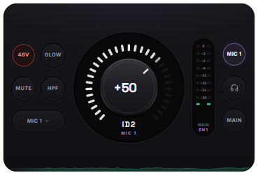

# iD Interface — Open-Source Audient iD1, iD2, iD2+ & iD4+ (MK3) Software & Mixer

A fast, lightweight, open-source replacement mixer, DSP studio console, and floating desktop volume controller built specifically for the **Audient iD MK3 series** (**iD1**, **iD2**, **iD2+**, and **iD4+**) on **Windows, macOS & Linux** — powered by **Rust + Tauri v2** with zero-bloat native WebView rendering.

> **Supported Hardware:** Designed exclusively for the 4 **Audient iD MK3** audio interfaces: **iD1**, **iD2**, **iD2+**, and **iD4+**. *(Legacy MK1/MK2 models such as iD4, iD14, iD24, and iD44 are not targeted.)*

<p align="center">
  
</p>

<p align="center">
  <a href="https://github.com/1ps3/iD-Interface/releases/latest"><b>⬇ Download the latest release (Windows, macOS &amp; Linux)</b></a>
</p>

---

## Download & Install

Grab the latest build from **[Releases](https://github.com/1ps3/iD-Interface/releases/latest)**:

| Platform | File | Notes |
| --- | --- | --- |
| **Windows 10/11** | `iD Interface_x.y.z_x64-setup.exe` | Recommended installer |
| **Windows (portable)** | `id-interface.exe` | No install — just run it |
| **macOS (Apple Silicon + Intel)** | `iD Interface_x.y.z_universal.dmg` | Drag to Applications |
| **Linux (Debian / Ubuntu)** | `iD Interface_x.y.z_amd64.deb` | Auto-installs Audient USB `udev` rule |
| **Linux (AppImage)** | `iD Interface_x.y.z_amd64.AppImage` | Portable — install [99-audient-id.rules](packaging/linux/99-audient-id.rules) for non-root USB |

* **Updates:** Built-in **1-click self-updater** (Windows & macOS) — checks GitHub Releases on launch, shows an **`UPDATE vX.Y.Z`** badge in the top bar (or **Settings → CHECK**), and downloads, installs, and restarts automatically. On Linux, it opens the latest `.AppImage` / `.deb` release download.
* **macOS first launch:** Builds are not notarized yet, so run `xattr -cr "/Applications/iD Interface.app"` once (or right-click → Open).
* **Linux AppImage USB permissions:** Copy [packaging/linux/99-audient-id.rules](packaging/linux/99-audient-id.rules) to `/etc/udev/rules.d/` and run `sudo udevadm control --reload-rules && sudo udevadm trigger` (the `.deb` package does this automatically).
* **Windows SmartScreen:** Builds are not code-signed yet — click **More info → Run anyway**.

---

## Compact Floating Mode

Collapse the full console into a resizable, always-on-top hardware faceplate for instant monitor volume, headphone level, preamp gain, 48V, mute, dim, HPF, and live metering — with a single click (`C`) back to the full desk.

<p align="center">
  
</p>

---

## What's New & Why iD Interface vs. Audient iD Control?

### Beyond Official iD Control
* **Zero Background Bloat (Windows, macOS & Linux):** Talks directly to your **iD1 / iD2 / iD2+ / iD4+** over **Direct USB** (TUSBAudio on Windows, native IOKit alongside CoreAudio on macOS, native `usbdevfs` alongside ALSA/PipeWire/JACK on Linux) — no `AudientDeviceManager` or Apple Bonjour required, and full **Linux** support that Audient never shipped. *(You can still switch to ADM mode anytime in Settings on Windows/macOS.)*
* **Remembers Sample Rate, Buffer Size & Clock Source:** Automatically saves your chosen **Sample Rate**, **ASIO Buffer Size**, and **Clock Source** and restores them to your interface on app launch or USB replug — no more resetting every time you reconnect.
* **Compact Floating Controller:** Collapse the full mixer into a sleek, always-on-top mini faceplate (`C`) for instant monitor/headphone volume, preamp gain, 48V, mute, dim, HPF, and live metering.
* **Rebindable Hardware Function Button (Direct USB):** Map the physical **Fn** button on your iD MK3 to **Mute Mics (1 + 2)**, **Mute Mic 1**, **Mute Mic 2**, **Mute Headphones**, **Speakers / Headphones Swap**, **Mid / Side Check**, **Reference Level Recall**, **Global Mute (All Outputs)**, **Bypass Input DSP (A/B)**, or **Toggle Scene 1–4** (plus all standard Audient hardware functions).
* **4 Instant Studio Scenes + Auto-Saving Working Scene:** Recall up to 4 full desk setups (`Alt+1–4` / `⌥1–4`), click an active scene to toggle back to your continuously saved live mix, and commit your desk directly to **onboard hardware flash** (`SAVE` / `RELOAD`, plus auto-save on close). Only changed parameters are written, so swaps are near-instant.
* **9 Studio Themes + macOS Liquid Glass:** Pure Monochrome, Tactile Carbon, Warm Vintage, Brushed Gunmetal, Studio Daylight, Powdercoat Slate, Audient iD MK3, Prism Studio, Stealth Obsidian — plus an adaptive **Liquid Glass** theme on macOS that auto-syncs with system Light/Dark mode.
* **True Desktop Integration:** Native Windows DWM window frame (Aero Snap, `Win+↑/↓`, `F11` fullscreen), macOS top Menu Bar mode (hides cleanly from the Dock), theme-matched right-click tray menu, first-close tray/quit prompt, persistent window & compact positions, and a **1-click self-updater**.

### Full Studio Console & Hardware DSP
* **4-Bus Mixer (`Main Mix`, `Mix A`, `Mix B`, `Reverb`)** with Dual Peak + RMS metering, custom channel scribble strips, and instant `STEREO`/`MONO` pairing.
* **Zero-Scroll Channel Strip & DSP Deck:** Preamp Gain, 48V, Mute, V-HPF, V-Phase, Tone (`Glow` / `HMX` / `Lift` / `Orbit`), 4-band Parametric EQ with live SVG response curve, Compressor with hardware GR meter and discrete `2:1 / 4:1 / 8:1 / 16:1` ratios, DSP Order, Record FX, and Reverb Send — all unlocked up to **96 kHz** and cleanly faded until engaged.
* **Preamps + SmartGain**, **3D RoomTune Monitoring Soundstage** (hardware-verified Bypass, Profile Trim, and Speaker L/R Trim & Delay), and **Output & Loopback Routing Matrix** (with Virtual Thru loud-output guard).

---

## Keyboard Shortcuts
| Shortcut | Action |
| --- | --- |
| `M` | Main Mute |
| `D` | Dim |
| `O` | Mono |
| `T` | Talkback |
| `C` | Toggle Compact / Full Console |
| `Alt+1–4` / `⌥1–4` | Recall / Toggle Saved Scenes 1–4 |
| `Shift + Drag / Scroll` | Fine trim adjustment |

---

## Building From Source

### Prerequisites
* [Rust](https://rustup.rs/) (`stable`)
* Tauri CLI v2: `cargo install tauri-cli --version "^2.0"`

### Windows (PowerShell)
```powershell
.\build-windows.ps1
```
Outputs standalone `id-interface.exe` and NSIS installer in `src-tauri\target\release\`.

### macOS (Apple Silicon & Intel Universal)
```bash
chmod +x build-macos.sh
./build-macos.sh --universal
```
Outputs a Universal `.app` and `.dmg` in `src-tauri/target/universal-apple-darwin/release/bundle/`.
*(First launch on unsigned macOS builds: `xattr -cr "/Applications/iD Interface.app"`)*

### Linux (`.deb` & `.AppImage`)
```bash
sudo apt-get install -y libwebkit2gtk-4.1-dev libappindicator3-dev librsvg2-dev patchelf libssl-dev
cargo tauri build
```
Outputs `.deb` and `.AppImage` in `src-tauri/target/release/bundle/`.

---

## Releasing a New Version (maintainers)
1. Bump `version` in `src-tauri/tauri.conf.json` and `src-tauri/Cargo.toml`.
2. Commit, then tag and push: `git tag v0.3.1 && git push origin main --tags`
3. GitHub Actions builds Windows + macOS + Linux, publishes the Release, and existing users get the update badge automatically.

---

## License & Disclaimer
[MIT](LICENSE). Independent community project — not affiliated with or endorsed by Audient Ltd.

---

## FAQ

**Does iD Interface replace Audient iD Control / Audient Device Manager (ADM)?**
Yes — on **Windows, macOS, and Linux**, iD Interface runs completely standalone over **Direct USB** without needing `AudientDeviceManager`, `iD Control`, or Apple Bonjour running in the background. (You can still switch to ADM mode in Settings on Windows/macOS if you prefer.)

**Does it work on Linux with PipeWire / ALSA / JACK?**
Yes! Audient iD MK3 interfaces are standard USB Audio Class 2.0 devices, so Linux handles audio streaming natively while **iD Interface** controls the onboard DSP mixer, preamps, EQ, compressor, RoomTune, and monitor controller directly over `usbdevfs` without interrupting audio playback.

**Which Audient audio interfaces are supported?**
iD Interface is built specifically for the 4 **Audient iD MK3** models: **Audient iD1**, **Audient iD2**, **Audient iD2+**, and **Audient iD4+**. Legacy MK1/MK2 models (iD4, iD14, iD24, iD44) use an older protocol and are not supported.

**How do updates work?**
iD Interface checks GitHub Releases automatically and shows an **`UPDATE`** badge when a new version is out. Clicking it downloads, installs, and restarts the app automatically on Windows and macOS, or opens the latest `.AppImage` / `.deb` download on Linux.
